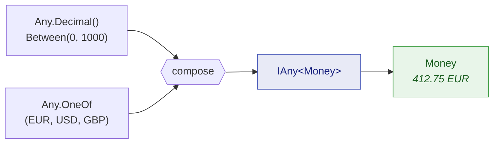

# Composition

🌍 **Languages:**  
🇬🇧 English (this file) | 🇫🇷 [Français](./composition.fr.md)

The built-in generators cover primitives. Your code is made of order references, money, customers
and aggregates. This page is about crossing that gap — turning constrained primitives into dummies
for **your** types, without ever producing a value your own constructor would reject.

## `.As(...)`: from a primitive to your type

A value object usually wraps a primitive behind a factory that validates. Constrain the primitive so
that it satisfies the factory, then hand the factory to `.As(...)`:

```csharp
// OrderReference.Create demands the "ORD-" prefix and a length of 12. The constraints
// are chosen so that every drawn string clears that bar — never so an assertion passes.
IAny<OrderReference> referenceGenerator = Any.String()
                                             .StartingWith("ORD-")
                                             .WithLength(12)
                                             .As(OrderReference.Create);

OrderReference anyReference = referenceGenerator.Generate();
```

`.As(...)` takes an `IAny<TSource>` and a `Func<TSource, TResult>` and returns an `IAny<TResult>` —
a generator like any other, which can be stored, passed around, put in a collection, or made
nullable.

This is the supported route to a type with a stricter contract, and it has a property worth naming:
the factory is your real one. If the constraints are too loose, the factory throws, and you find out
immediately rather than shipping a dummy that could never exist in production.

## `Any.Combine`: several generators into one

When a type needs more than one input, `Any.Combine` draws from each generator and feeds a composer:



```csharp
IAny<Money> anyMoney = Any.Combine(
    Any.Decimal().Between(0m, 1_000m).WithScale(2),
    Any.OneOf("EUR", "USD", "GBP"),
    Money.Create);

Money anyPrice = anyMoney.Generate();
```

The composer can be a method group, as above, or a lambda when the shape needs adjusting. Overloads
exist for two through eight generators.

Every operand must actually be **used** by the composer. An operand that is drawn and thrown away is
almost always a mistake — a parameter left unread after a refactor — so it is diagnostic
[JD027](../analyzers/JD027.en.md). When the draw really is deliberate, name the parameter `_` to say
so.

## When eight is not enough

The arity stops at eight on purpose
([ADR-0005](../../for-maintainers/adr/0005-cap-any-combine-at-arity-eight.md)). A type needing more
than eight independent inputs is a type that wants intermediate structure, and composing that
structure is both the workaround and the better design:

```csharp
// Compose the parts first...
IAny<Money>          anyPrice     = Any.Combine(Any.Decimal().Between(0m, 1_000m).WithScale(2),
                                                Any.OneOf("EUR", "USD", "GBP"),
                                                Money.Create);
IAny<OrderReference> anyReference = Any.String().StartingWith("ORD-").WithLength(12).As(OrderReference.Create);

// ...then combine the parts, not the primitives.
IAny<string> anySummary = Any.Combine(
    anyReference,
    anyPrice,
    Any.Enum<OrderStatus>(),
    (orderRef, price, status) => $"{orderRef} — {price} — {status}");
```

A composed generator is an ordinary `IAny<T>`, so it feeds another `Combine`, a collection, or an
`.As(...)` exactly like a primitive one does. That is what makes the cap a shape constraint rather
than a ceiling.

## `Any.PairOf` and `Any.TripleOf`

When all you want is the tuple, and no composer would add anything, two shorthands exist:

```csharp
IAny<(int Quantity, decimal UnitPrice)> anyLine = Any.PairOf(
    Any.Int32().Between(1, 100),
    Any.Decimal().Between(0.01m, 500m).WithScale(2));

(int quantity, decimal unitPrice) = anyLine.Generate();

IAny<(Guid, string, OrderStatus)> anyRow = Any.TripleOf(
    Any.Guid().NonEmpty(),
    Any.String().Alpha().WithLengthBetween(3, 20),
    Any.Enum<OrderStatus>());
```

## `Any.OrderedPair`: two values tied by an order

A span's start and end, a range's minimum and maximum: two values a constructor refuses in the wrong
order. Two independent draws break that order about half the time, and deriving the end from the start
by hand cannot be inverted — pinning the end must constrain the start. `Any.OrderedPair(first, second)`
exists on every ordered builder and draws the pair by construction: the first from its base kept at or
below the largest value the second base can produce, then the second from its base kept at or above it.
A pin bounds the other draw the same way, in either direction.

```csharp
AnyOrderedPair<int> datingGenerator = Any.OrderedPair(Any.Int32().Between(-800, 1600), Any.Int32().Between(-800, 1600));

(int anyDatedFrom, int anyDatedTo)   = datingGenerator.Generate();                    // anyDatedFrom <= anyDatedTo
(int anyEarlyFrom, int anyEarlyTo)   = datingGenerator.WithSecond(-500).Generate();   // the start follows the pinned end: -800 to -500
(int anyLateFrom, int anyLateTo)     = datingGenerator.WithFirst(1500).Generate();    // the end follows the pinned start: 1500 to 1600
(int anyStrictLow, int anyStrictHigh) = Any.OrderedPair(Any.Int32().Between(0, 100), Any.Int32().Between(0, 100), strict: true).Generate();
```

`strict: true` makes the first strictly below the second, through the base's own strict bound. Two pins
in the wrong order, or a pin no value of the other base can follow — `WithFirst(1700)` when the second
base ends at 1600 — are refused at the call naming both sides. A pinned value is a literal, like
`Any.Fixed`: it is checked against the other base, not its own.

`TimeOnly` has no pair: once a window crosses midnight its order is cyclic, and neither reading of
"first before second" is right everywhere. Three ordered values — a minimum, an optimum, a maximum —
are a pair and a `.Then(...)` drawing the middle one between its two sides
([ADR-0126](../../for-maintainers/adr/0126-draw-two-values-tied-by-an-order.md)):

```csharp
IAny<(int Min, int Optimum, int Max)> setPointsGenerator = Any.OrderedPair(Any.Int32().Between(0, 100), Any.Int32().Between(0, 100), strict: true)
    .Then(pair => Any.Int32().Between(pair.First, pair.Second).As(optimum => (pair.First, optimum, pair.Second)));
```

## `.OrNull()`: optional values

An optional field deserves a dummy that is sometimes absent — otherwise the null branch is never
exercised. `.OrNull()` yields `null` one draw in ten and, otherwise, a value satisfying
everything declared upstream. Absent is a limit value of an optional, drawn as often as a
floating-point draw reaches its type's edge: rare enough that the present case dominates, frequent
enough that a suite run regularly meets the null branch
([ADR-0117](../../for-maintainers/adr/0117-draw-a-limit-value-the-type-permits-one-draw-in-ten.md)):

```csharp
// Value types: int?, DateTime?, Guid?, an enum...
int?      anyDiscount  = Any.Int32().Between(0, 100).OrNull().Generate();
DateTime? anyCancelled = Any.DateTime().Before(new DateTime(2030, 1, 1)).OrNull().Generate();

// Reference types: a nullable string, or a value object built through .As(...)
string?         anyNote      = Any.String().Alpha().WithLengthBetween(1, 40).OrNull().Generate();
OrderReference? anyReference = Any.String().StartingWith("ORD-").WithLength(12)
                                  .As(OrderReference.Create)
                                  .OrNull()
                                  .Generate();
```

There are two extension classes behind that single spelling — `NullableExtensions` for value types
and `NullableReferenceExtensions` for reference types — because one overload constrained to `struct`
and another to `class` would collide. You never pick between them: the compiler does, from the type
you are generating.

The null-versus-value decision draws from the same random context as the wrapped generator, so a
seeded run replays it exactly. A `null` draw does not consume a value from the wrapped generator.

Inside a **distinct** collection, `null` counts as one additional value in the wrapped generator's domain.
`Any.SetOf(Any.Enum<OrderStatus>().OrNull())` therefore holds at most the enum's members and `null`,
and never asks for more.

## `.AsNullable()`: a nullable type, never an absent value

The opposite of `.OrNull()`, and the one you want far more often than the name suggests. A parameter
spelled `OrderStatus?` still has to be given a value; if the test does not care which, the dummy for it is
*not* sometimes-absent — an absent one exercises a branch the test never asked about.
`.AsNullable()` widens the type and leaves the values alone:

```csharp
OrderStatus? anyStatus = Any.Enum<OrderStatus>().AsNullable().Generate();   // never null
int?         anyUnits  = Any.Int32().Between(1, 10).AsNullable().Generate();
```

It matters most inside a **distinct** collection. `.As(value => (OrderStatus?)value)` would say the same
thing about the type and nothing at all about the domain, so a set could not tell how many distinct
values it had to draw from and would ask for more than exist:

```csharp
// The enum has a fixed number of members, so a set of them holds at most that many — and this knows it.
ISet<OrderStatus?> anyStatuses = Any.SetOf(Any.Enum<OrderStatus>().AsNullable()).NonEmpty().Generate();
```

A generator scaffolded by `any` writes `.AsNullable()` for every nullable value-type parameter, for
exactly that reason.

## `Any.Fixed`: a value you chose, in a generator's shape

Some places want an `IAny<T>` where the value is not a dummy at all: an operand of `Any.Combine` the test
is about, the pinned parameter of a scaffolded generator, the branch of a draw that should not vary.
`Any.Fixed(value)` hands that literal over as a generator:

```csharp
// The amount is what the test is about, so it stays a literal; the reference and the name are dummies.
IAny<Order> orderGenerator = Any.Combine(
    Any.String().StartingWith("ORD-").WithLength(12).As(OrderReference.Create),
    Any.String().Alpha().WithLengthBetween(3, 20),
    Any.Fixed(120.00m),
    (reference, customerName, amount) => new Order(reference, customerName, amount));
```

It draws nothing, so the values drawn around it replay exactly as they would without it, and it accepts
`null` — `Any.Fixed<string?>(null)` is how a nullable parameter is pinned to its absent case. It returns the
same instance on every call: pin an immutable value, because a mutable one is shared by everything built
from the generator ([ADR-0118](../../for-maintainers/adr/0118-return-a-literal-through-any-fixed.md)).

## `.DifferentFrom(value)` on any generator

Every typed builder carries a `DifferentFrom` of its own, checked when it is declared. A generator seen
only as an `IAny<T>` — one built by `As` or `Combine`, a scaffolded one — gets one too: it redraws while
the value equals the one given, a bounded number of times, and fails with its seed when the generator
yields nothing else.

```csharp
IAny<string> pitchGenerator = Any.Combine(Any.OneOf("A", "B", "C"), Any.OneOf("3", "4"), (note, octave) => note + octave);

string anyFirst  = pitchGenerator.Generate();
string anySecond = pitchGenerator.DifferentFrom(anyFirst).Generate();
```

The two are different guarantees under one name, and the receiver's static type picks one: the
builder's refuses a contradiction at once, naming both constraints, and the analyzers see it at build
time; this one sees nothing before `Generate()` ([ADR-0121](../../for-maintainers/adr/0121-exclude-a-value-from-any-generator-by-redrawing.md)).

## A bound taken from another draw

When one value must sit under another — a count of cells under a sample's capacity, a deadline after a
start — draw the first, then use it as an ordinary bound for the second:

```csharp
int anyCapacity = Any.Int32().Between(10, 500).Generate();
int anyCells    = Any.Int32().GreaterThanOrEqualTo(1).LessThan(anyCapacity).Generate();
```

That is idiomatic at a call site: the bound is a plain value, and both draws replay from the one seed. If the
rule belongs to the type rather than to this test, write it once in the generator instead, as one generator
that draws both together: [When a guard ties two parameters](../packages/justdummies-cli.en.md#when-a-guard-ties-two-parameters)
shows the three forms, and [Design principles](./design-principles.en.md#what-this-means-for-you-day-to-day)
says why the library leaves it to you.

## `.Then(...)`: a draw that depends on another

When the second value is not merely bounded by the first but *built* from it — a grid's cells inside its
drawn dimensions, a measure filled to its drawn time signature — draw the first, and let `.Then(...)` build
the generator for the second from it:

```csharp
IAny<(int Width, int Height, int Cell)> gridGenerator = Any.Combine(
        Any.Int32().Between(1, 20),
        Any.Int32().Between(1, 20),
        (width, height) => (width, height))
    .Then(size => Any.Int32().Between(0, size.width * size.height - 1)
                     .As(cell => (size.width, size.height, cell)));
```

It is one recipe: the inner generator draws on the same source as the outer one, so the chain replays from
one seed — under an explicit `Any.WithSeed(...)` context too, where a `Generate()` written inside an
`As(...)` would draw the inner value from the ambient seed instead. It is a sequential draw, correct by
construction, never a search ([ADR-0119](../../for-maintainers/adr/0119-draw-a-value-that-depends-on-another-draw.md)).

Choosing among generators is the same move: the branch not taken is never drawn.

```csharp
IAny<int> signedGenerator = Any.Boolean().Then(positive => positive ? Any.Int32().Positive() : Any.Int32().Negative());
```

## Building a whole aggregate

Putting it together, here is a dummy for a record with three fields, none of which is a bare
primitive at the call site:

```csharp
IAny<Customer> customerGenerator = Any.Combine(
    Any.Guid().NonEmpty(),
    Any.String().Alpha().WithLengthBetween(3, 20),
    Any.String().Alpha().InLowerCase().WithLengthBetween(3, 12),
    (id, name, localPart) => new Customer(id, name, $"{localPart}@example.test"));

Customer anyCustomer = customerGenerator.Generate();

// A generator is a recipe, so the same one produces a whole list of distinct customers.
List<Customer> anyCustomers = Any.ListOf(customerGenerator).WithCountBetween(2, 5).Generate();
```

Keep such a generator in a `static readonly` field of your test class and every test in the file
gets a valid customer for one call — with no shared mutable state, because generators are immutable.

---

[← Documentation index](../README.md)
