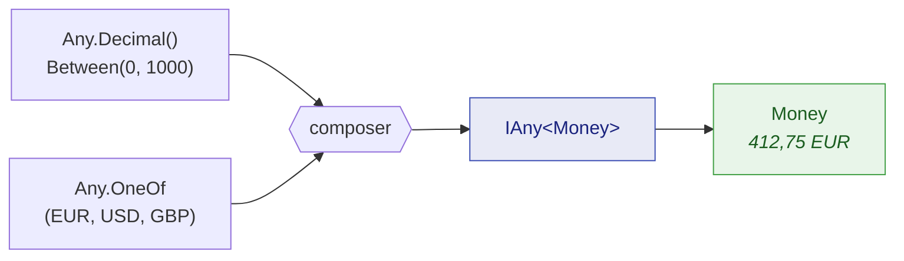

# Composition

🌍 **Langues :**  
🇬🇧 [English](./composition.en.md) | 🇫🇷 Français (ce fichier)

Les générateurs fournis couvrent les primitifs. Votre code, lui, est fait de références de commande,
de montants, de clients et d'agrégats. Cette page traite du franchissement de cet écart : transformer
des primitifs contraints en dummies pour **vos** types, sans jamais produire une valeur que votre
propre constructeur refuserait.

## `.As(...)` : d'un primitif vers votre type

Un objet-valeur enveloppe généralement un primitif derrière une fabrique qui valide. Contraignez le
primitif pour qu'il satisfasse la fabrique, puis passez la fabrique à `.As(...)` :

```csharp
// OrderReference.Create exige le préfixe « ORD- » et une longueur de 12. Les contraintes
// sont choisies pour que toute chaîne tirée franchisse cette barre — jamais pour faire
// passer une assertion.
IAny<OrderReference> referenceGenerator = Any.String()
                                             .StartingWith("ORD-")
                                             .WithLength(12)
                                             .As(OrderReference.Create);

OrderReference anyReference = referenceGenerator.Generate();
```

`.As(...)` prend un `IAny<TSource>` et un `Func<TSource, TResult>` et renvoie un `IAny<TResult>` —
un générateur comme un autre, que l'on peut stocker, faire circuler, placer dans une collection ou
rendre nullable.

C'est la voie prévue vers un type au contrat plus strict, et elle a une propriété qui mérite d'être
nommée : la fabrique est la vraie. Si les contraintes sont trop lâches, la fabrique lève une
exception, et vous l'apprenez immédiatement au lieu de livrer un dummy qui n'aurait jamais pu
exister en production.

## `Any.Combine` : plusieurs générateurs en un seul

Quand un type demande plus d'une entrée, `Any.Combine` tire de chaque générateur et alimente un
composeur :



```csharp
IAny<Money> anyMoney = Any.Combine(
    Any.Decimal().Between(0m, 1_000m).WithScale(2),
    Any.OneOf("EUR", "USD", "GBP"),
    Money.Create);

Money anyPrice = anyMoney.Generate();
```

Le composeur peut être un groupe de méthodes, comme ci-dessus, ou une lambda quand la forme demande
un ajustement. Des surcharges existent de deux à huit générateurs.

Chaque opérande doit être réellement **utilisé** par le composeur. Un opérande tiré puis jeté est
presque toujours une erreur — un paramètre resté non lu après un remaniement — d'où le diagnostic
[JD027](../analyzers/JD027.fr.md). Quand le tirage est vraiment délibéré, nommez le paramètre `_`
pour le dire.

## Quand huit ne suffit pas

L'arité s'arrête à huit volontairement
([ADR-0005](../../for-maintainers/adr/0005-cap-any-combine-at-arity-eight.fr.md)). Un type réclamant
plus de huit entrées indépendantes est un type qui appelle une structure intermédiaire, et composer
cette structure est à la fois le contournement et la meilleure conception :

```csharp
// Composez d'abord les parties...
IAny<Money>          anyPrice     = Any.Combine(Any.Decimal().Between(0m, 1_000m).WithScale(2),
                                                Any.OneOf("EUR", "USD", "GBP"),
                                                Money.Create);
IAny<OrderReference> anyReference = Any.String().StartingWith("ORD-").WithLength(12).As(OrderReference.Create);

// ...puis combinez les parties, non les primitifs.
IAny<string> anySummary = Any.Combine(
    anyReference,
    anyPrice,
    Any.Enum<OrderStatus>(),
    (orderRef, price, status) => $"{orderRef} — {price} — {status}");
```

Un générateur composé est un `IAny<T>` ordinaire : il alimente un autre `Combine`, une collection ou
un `.As(...)` exactement comme un générateur primitif. C'est ce qui fait du plafond une contrainte
de forme plutôt qu'une limite.

## `Any.PairOf` et `Any.TripleOf`

Quand seul le tuple vous intéresse et qu'aucun composeur n'apporterait quoi que ce soit, deux
raccourcis existent :

```csharp
IAny<(int Quantity, decimal UnitPrice)> anyLine = Any.PairOf(
    Any.Int32().Between(1, 100),
    Any.Decimal().Between(0.01m, 500m).WithScale(2));

(int quantity, decimal unitPrice) = anyLine.Generate();

IAny<(Guid, string, OrderStatus)> anyRow = Any.TripleOf(
    Any.Guid().NonEmpty(),
    Any.String().Alpha().WithLengthBetween(3, 20),
    Any.Enum<OrderStatus>());
```

## `Any.OrderedPair` : deux valeurs liées par un ordre

Le début et la fin d'une période, le minimum et le maximum d'une plage : deux valeurs qu'un constructeur
refuse dans le mauvais ordre. Deux tirages indépendants brisent cet ordre une fois sur deux, et dériver
la fin du début à la main ne s'inverse pas — épingler la fin doit contraindre le début.
`Any.OrderedPair(first, second)` existe sur chaque builder ordonné et tire la paire par construction : le
premier depuis sa base maintenue au plus à la plus grande valeur que la seconde base peut produire, puis
le second depuis sa base maintenue au moins au premier. Une épingle borne l'autre tirage de la même
façon, dans les deux sens.

```csharp
AnyOrderedPair<int> datingGenerator = Any.OrderedPair(Any.Int32().Between(-800, 1600), Any.Int32().Between(-800, 1600));

(int anyDatedFrom, int anyDatedTo)   = datingGenerator.Generate();                    // anyDatedFrom <= anyDatedTo
(int anyEarlyFrom, int anyEarlyTo)   = datingGenerator.WithSecond(-500).Generate();   // the start follows the pinned end: -800 to -500
(int anyLateFrom, int anyLateTo)     = datingGenerator.WithFirst(1500).Generate();    // the end follows the pinned start: 1500 to 1600
(int anyStrictLow, int anyStrictHigh) = Any.OrderedPair(Any.Int32().Between(0, 100), Any.Int32().Between(0, 100), strict: true).Generate();
```

`strict: true` place le premier strictement sous le second, par la borne stricte de la base elle-même.
Deux épingles dans le mauvais ordre, ou une épingle qu'aucune valeur de l'autre base ne peut suivre —
`WithFirst(1700)` quand la seconde base s'arrête à 1600 — sont refusées à l'appel en nommant les deux
côtés. Une valeur épinglée est un littéral, comme `Any.Fixed` : elle est vérifiée contre l'autre base,
pas contre la sienne.

`TimeOnly` n'a pas de paire : dès qu'une fenêtre franchit minuit son ordre est cyclique, et aucune lecture
de « le premier avant le second » n'est la bonne partout. Trois valeurs ordonnées — un minimum, un
optimum, un maximum — sont une paire et un `.Then(...)` qui tire celle du milieu entre les deux
([ADR-0126](../../for-maintainers/adr/0126-draw-two-values-tied-by-an-order.fr.md)) :

```csharp
IAny<(int Min, int Optimum, int Max)> setPointsGenerator = Any.OrderedPair(Any.Int32().Between(0, 100), Any.Int32().Between(0, 100), strict: true)
    .Then(pair => Any.Int32().Between(pair.First, pair.Second).As(optimum => (pair.First, optimum, pair.Second)));
```

## `.OrNull()` : les valeurs optionnelles

Un champ optionnel mérite un dummy parfois absent — sinon la branche nulle n'est jamais exercée.
`.OrNull()` produit `null` un tirage sur dix et, sinon, une valeur satisfaisant tout ce qui a été
déclaré en amont. L'absence est une valeur limite d'un optionnel, tirée aussi souvent qu'un tirage
flottant atteint le bord de son type : assez rare pour que le cas présent domine, assez fréquente pour
qu'une exécution de la suite rencontre régulièrement la branche nulle
([ADR-0117](../../for-maintainers/adr/0117-draw-a-limit-value-the-type-permits-one-draw-in-ten.fr.md)) :

```csharp
// Types valeur : int?, DateTime?, Guid?, une énumération...
int?      anyDiscount  = Any.Int32().Between(0, 100).OrNull().Generate();
DateTime? anyCancelled = Any.DateTime().Before(new DateTime(2030, 1, 1)).OrNull().Generate();

// Types référence : une chaîne nullable, ou un objet-valeur construit via .As(...)
string?         anyNote      = Any.String().Alpha().WithLengthBetween(1, 40).OrNull().Generate();
OrderReference? anyReference = Any.String().StartingWith("ORD-").WithLength(12)
                                  .As(OrderReference.Create)
                                  .OrNull()
                                  .Generate();
```

Deux classes d'extension se cachent derrière cette écriture unique — `NullableExtensions` pour les
types valeur et `NullableReferenceExtensions` pour les types référence — car une surcharge contrainte
à `struct` et une autre à `class` entreraient en collision. Vous ne choisissez jamais entre elles :
le compilateur le fait, d'après le type que vous générez.

La décision « null ou valeur » tire du même contexte aléatoire que le générateur enveloppé : une
exécution graînée la rejoue donc exactement. Un tirage `null` ne consomme pas de valeur du
générateur enveloppé.

Dans une collection **distincte**, `null` compte comme une valeur supplémentaire dans le domaine du
générateur enveloppé. `Any.SetOf(Any.Enum<OrderStatus>().OrNull())` contient donc au plus les membres de
l'énumération et `null`, et n'en demande jamais davantage.

## `.AsNullable()` : un type nullable, jamais une valeur absente

L'opposé de `.OrNull()`, et celui dont vous avez besoin bien plus souvent que le nom ne le laisse
croire. Un paramètre écrit `OrderStatus?` doit quand même recevoir une valeur ; si le test se moque
de laquelle, le dummy qui lui convient n'est *pas* parfois-absent — un dummy absent exerce une
branche que le test n'a jamais demandée. `.AsNullable()` élargit le type et laisse les valeurs
tranquilles :

```csharp
OrderStatus? anyStatus = Any.Enum<OrderStatus>().AsNullable().Generate();   // jamais null
int?         anyUnits  = Any.Int32().Between(1, 10).AsNullable().Generate();
```

Ça compte surtout à l'intérieur d'une collection **distincte**. `.As(value => (OrderStatus?)value)`
dirait la même chose du type et rien du tout du domaine : un ensemble ne saurait donc pas dans
combien de valeurs distinctes il a le droit de puiser, et en demanderait plus qu'il n'en existe.

```csharp
// L'énum a un nombre de membres fixe, donc un ensemble en contient au plus autant — et ceci le sait.
ISet<OrderStatus?> anyStatuses = Any.SetOf(Any.Enum<OrderStatus>().AsNullable()).NonEmpty().Generate();
```

Un générateur scaffoldé par `any` écrit `.AsNullable()` pour chaque paramètre nullable de type
valeur, exactement pour cette raison.

## `Any.Fixed` : une valeur que vous avez choisie, sous la forme d'un générateur

Certains endroits attendent un `IAny<T>` là où la valeur n'est pas un dummy du tout : un opérande
d'`Any.Combine` sur lequel porte le test, le paramètre épinglé d'un générateur scaffoldé, la branche d'un tirage
qui ne doit pas varier. `Any.Fixed(value)` y passe ce littéral comme un générateur :

```csharp
// Le montant est ce sur quoi porte le test : il reste un littéral ; la référence et le nom sont des dummies.
IAny<Order> orderGenerator = Any.Combine(
    Any.String().StartingWith("ORD-").WithLength(12).As(OrderReference.Create),
    Any.String().Alpha().WithLengthBetween(3, 20),
    Any.Fixed(120.00m),
    (reference, customerName, amount) => new Order(reference, customerName, amount));
```

Il ne tire rien, si bien que les valeurs tirées autour de lui se rejouent exactement comme sans lui, et il
accepte `null` — `Any.Fixed<string?>(null)` est la façon d'épingler un paramètre nullable sur son cas absent.
Il renvoie la même instance à chaque appel : épinglez une valeur immuable, car une valeur mutable est partagée
par tout ce que le générateur construit ([ADR-0118](../../for-maintainers/adr/0118-return-a-literal-through-any-fixed.fr.md)).

## `.DifferentFrom(value)` sur tout générateur

Chaque builder typé porte un `DifferentFrom` qui lui est propre, vérifié à la déclaration. Un générateur vu
seulement comme un `IAny<T>` — construit par `As` ou `Combine`, ou scaffoldé — en reçoit un aussi : il
retire tant que la valeur égale celle donnée, un nombre borné de fois, et échoue avec sa graine quand le
générateur ne produit rien d'autre.

```csharp
IAny<string> pitchGenerator = Any.Combine(Any.OneOf("A", "B", "C"), Any.OneOf("3", "4"), (note, octave) => note + octave);

string anyFirst  = pitchGenerator.Generate();
string anySecond = pitchGenerator.DifferentFrom(anyFirst).Generate();
```

Ce sont deux garanties différentes sous un même nom, et le type statique du receveur en choisit une : celle
du builder refuse une contradiction tout de suite, en nommant les deux contraintes, et les analyzers la voient
à la compilation ; celle-ci ne voit rien avant `Generate()` ([ADR-0121](../../for-maintainers/adr/0121-exclude-a-value-from-any-generator-by-redrawing.fr.md)).

## Une borne prise sur un autre tirage

Quand une valeur doit se tenir sous une autre — un nombre de cellules sous la capacité d'un échantillon, une
échéance après un début — tirez la première, puis servez-vous-en comme d'une borne ordinaire pour la seconde :

```csharp
int anyCapacity = Any.Int32().Between(10, 500).Generate();
int anyCells    = Any.Int32().GreaterThanOrEqualTo(1).LessThan(anyCapacity).Generate();
```

C'est idiomatique à un site d'appel : la borne est une valeur ordinaire, et les deux tirages se rejouent depuis
la même graine. Si la règle appartient au type plutôt qu'à ce test, écrivez-la une fois dans le générateur,
comme un seul générateur qui tire les deux ensemble : [Quand une garde relie deux paramètres](../packages/justdummies-cli.fr.md#quand-une-garde-relie-deux-paramètres)
montre les trois formes, et [Principes de conception](./design-principles.fr.md#ce-que-cela-change-au-quotidien)
dit pourquoi la bibliothèque vous le laisse.

## `.Then(...)` : un tirage qui dépend d'un autre

Quand la seconde valeur n'est pas seulement bornée par la première mais *construite* à partir d'elle — les
cellules d'une grille dans ses dimensions tirées, une mesure remplie jusqu'à sa signature rythmique tirée —
tirez la première, et laissez `.Then(...)` construire à partir d'elle le générateur de la seconde :

```csharp
IAny<(int Width, int Height, int Cell)> gridGenerator = Any.Combine(
        Any.Int32().Between(1, 20),
        Any.Int32().Between(1, 20),
        (width, height) => (width, height))
    .Then(size => Any.Int32().Between(0, size.width * size.height - 1)
                     .As(cell => (size.width, size.height, cell)));
```

C'est une seule recette : le générateur intérieur tire sur la même source que l'extérieur, si bien que la
chaîne se rejoue depuis une seule graine — sous un contexte `Any.WithSeed(...)` explicite aussi, là où un
`Generate()` écrit dans un `As(...)` tirerait la valeur intérieure de la graine ambiante. C'est un tirage
séquentiel, correct par construction, jamais une recherche
([ADR-0119](../../for-maintainers/adr/0119-draw-a-value-that-depends-on-another-draw.fr.md)).

Choisir parmi des générateurs est le même geste : la branche non retenue n'est jamais tirée.

```csharp
IAny<int> signedGenerator = Any.Boolean().Then(positive => positive ? Any.Int32().Positive() : Any.Int32().Negative());
```

## Construire un agrégat entier

En rassemblant tout, voici un dummy pour un enregistrement à trois champs, dont aucun n'est un
primitif nu sur le site d'appel :

```csharp
IAny<Customer> customerGenerator = Any.Combine(
    Any.Guid().NonEmpty(),
    Any.String().Alpha().WithLengthBetween(3, 20),
    Any.String().Alpha().InLowerCase().WithLengthBetween(3, 12),
    (id, name, localPart) => new Customer(id, name, $"{localPart}@example.test"));

Customer anyCustomer = customerGenerator.Generate();

// Un générateur est une recette : le même produit donc toute une liste de clients distincts.
List<Customer> anyCustomers = Any.ListOf(customerGenerator).WithCountBetween(2, 5).Generate();
```

Conservez un tel générateur dans un champ `static readonly` de votre classe de test et chaque test
du fichier obtient un client valide en un appel — sans état mutable partagé, puisque les générateurs
sont immuables.

---

[← Sommaire de la documentation](../README.fr.md)
