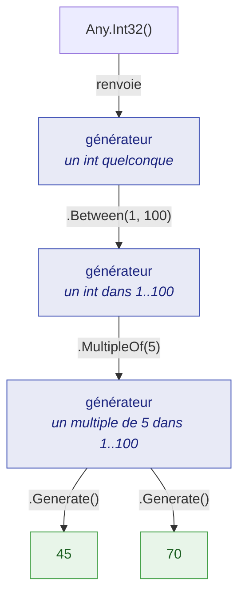
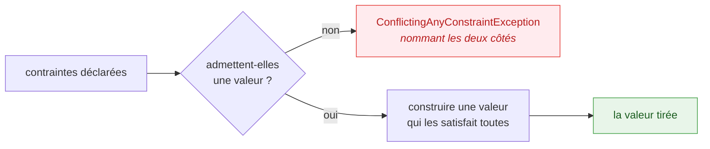

# Concepts fondamentaux

🌍 **Langues :**  
🇬🇧 [English](./core-concepts.en.md) | 🇫🇷 Français (ce fichier)

Cinq idées portent toute la bibliothèque. Une fois acquises, chaque générateur de la référence se
lit de la même façon, et les surprises cessent.

Toutes les cinq reposent sur la définition qu'ouvre [Démarrer](./getting-started.fr.md#quest-ce-quun-dummy)
— un dummy est une valeur dont un test a besoin et dont il ne se soucie pas. Tout ce qui suit décrit
comment la bibliothèque sert *cela* ; rien n'y transforme en dummy une valeur dont le test parle.

## Un générateur est une recette, pas une valeur

`Any.Int32()` ne donne pas un nombre. Il donne un `AnyInt32` — un objet décrivant quels nombres
seraient acceptables. Rien n'est tiré tant que `Generate()` n'est pas appelé, et chaque appel tire à
nouveau :

```csharp
AnyInt32 anyQuantity = Any.Int32().Between(1, 100);

int anyFirst  = anyQuantity.Generate();
int anySecond = anyQuantity.Generate();

// first et second sont tous deux dans 1..100, et sont généralement différents.
```

C'est la distinction sur laquelle repose toute l'API, et la raison pour laquelle le paquet embarque
des analyzers : une recette et une valeur satisfont beaucoup des mêmes signatures, le compilateur ne
peut donc pas signaler qu'on les a confondues. Écrire `$"{Any.Int32()}"` compile parfaitement et
produit la chaîne `"JustDummies.AnyInt32"`. C'est le diagnostic
[JD005](../analyzers/JD005.fr.md), et il existe précisément parce que rien d'autre ne l'aurait
attrapé.



## Les générateurs sont immuables

Une contrainte ne modifie jamais le générateur sur lequel elle est appelée. Elle en renvoie un
**nouveau**, porteur d'une exigence de plus, et laisse l'original exactement tel qu'il était :

```csharp
AnyString anyCode     = Any.String().Alpha().WithLength(8);
AnyString anyUpperCode = anyCode.InUpperCase();

string anyMixed = anyCode.Generate();      // 8 lettres, casse quelconque
string anyUpper = anyUpperCode.Generate(); // 8 lettres, majuscules
```

Deux conséquences en découlent, toutes deux utiles.

On peut **partager un générateur librement** — le placer dans un champ `static readonly`, le passer
à une méthode utilitaire, en dériver dix variantes — sans risquer que la contrainte d'un appelant ne
déborde sur celle d'un autre.

Et une contrainte dont on jette le résultat ne fait rien du tout. C'est une vraie erreur, facile à
commettre quand une chaîne est répartie sur plusieurs lignes ; elle a donc son propre diagnostic,
[JD006](../analyzers/JD006.fr.md) :

<!-- jd:allow=JD006 -->
```csharp
AnyString referenceGenerator = Any.String().WithLength(12);

referenceGenerator.StartingWith("ORD-"); // JD006 : le résultat est jeté, le préfixe est donc perdu

string anyReference = referenceGenerator.Generate(); // 12 caractères, sans préfixe
```

## `IAny<T>` est la couture sur laquelle tout se compose

Tout générateur implémente `IAny<T>`, dont l'unique membre est `Generate()`. Cette seule interface
permet de faire circuler, de stocker et de combiner des générateurs sans que le code receveur ait à
savoir quel type concret les a produits :

```csharp
static List<T> ThreeOf<T>(IAny<T> generator) {
    return [generator.Generate(), generator.Generate(), generator.Generate()];
}

List<int>    quantities = ThreeOf(Any.Int32().Between(1, 100));
List<string> references = ThreeOf(Any.String().StartingWith("ORD-").WithLength(12));
```

C'est aussi la monnaie d'échange de l'API de composition : `Any.ListOf`, `Any.Combine`, `.As(...)`
et `.OrNull()` prennent et renvoient tous des `IAny<T>`. Voir
[Composition](./composition.fr.md) pour ce que cela permet.

## Une contrainte énonce un invariant, jamais une assertion

C'est la règle qui décide si un test utilisant des dummies vaut quelque chose.

Une contrainte existe pour décrire **ce que le domaine garantit sur la valeur**. Elle ne doit jamais
être ajoutée pour faire passer une assertion. Prenons un test sur une règle disant que les frais de
port sont offerts au-delà d'un seuil :

<!-- jd:allow=JD036 -->
```csharp
// Anti-patron : la contrainte a été choisie pour rendre l'assertion vraie.
decimal anyOrderTotal = Any.Decimal().GreaterThan(100m).Generate();

Assert.Equal(0m, Shipping.FeeFor(anyOrderTotal));
```

Le test ne prouve plus rien sur le seuil — il prouve que le code est d'accord avec la contrainte que
le test a lui-même inventée. Pire : le jour où le seuil passe à 200, ce test passe toujours.

Le réflexe, à ce stade, est de relâcher la contrainte et de calculer l'attendu à partir de la valeur
tirée. N'en faites rien : cela échoue de la même façon, et y ajoute un défaut propre.

```csharp
// Toujours faux, d'une manière qui a l'air soigneuse.
decimal anyOrderTotal = Any.Decimal().Between(0m, 10_000m).WithScale(2).Generate();

decimal expected = anyOrderTotal > 100m ? 0m : 4.90m;   // la règle, recopiée dans le test

Assert.Equal(expected, Shipping.FeeFor(anyOrderTotal));
```

Ce test affirme que `Shipping.FeeFor` est d'accord avec une seconde copie de `Shipping.FeeFor`
écrite dans le corps du test : lui aussi survit donc au passage du seuil à 200. Et `anyOrderTotal`
n'a jamais été un dummy : les frais sont exactement ce qu'il décide, ce qui en fait une donnée
qui intervient dans ce que le test vérifie.

La version honnête écrit le seuil noir sur blanc, des deux côtés :

```csharp
// Le seuil est ce dont ces tests parlent : il est donc épelé plutôt que tiré.
Assert.Equal(0m,    Shipping.FeeFor(150m));   // au-dessus : offerts
Assert.Equal(4.90m, Shipping.FeeFor(50m));    // en dessous : facturés
```

Remarquez ce qui *ne figure pas* dans cet exemple : un dummy. Ce test n'en a aucun, et n'en a pas
besoin — chaque valeur qu'il manipule est une valeur dont il parle. Un dummy apparaîtrait dès lors
qu'il faudrait calculer les frais pour une commande entière, dont la règle ne consulte ni la
référence ni le client. **Prenez un dummy quand une valeur doit être là et ne doit pas compter ;
quand la valeur est le sujet, écrivez-la en littéral.**

Deux tests plutôt qu'un, c'est la forme à attendre ici : si vous ne pouvez pas exprimer le test sans
contraindre la valeur tirée à la forme de l'assertion, c'est que cette valeur n'est pas un dummy, et
ce qu'il vous faut est un littéral de chaque côté de la frontière.

## Les valeurs sont construites, pas filtrées

Quand une chaîne déclare plusieurs contraintes, JustDummies ne tire **pas** au hasard en
recommençant jusqu'à ce que quelque chose convienne. Il construit une valeur qui satisfait toute la
spécification par construction. Une exécution de `Any.Int32().Between(1, 100).MultipleOf(7)` choisit
parmi les multiples de sept de cet intervalle ; elle ne lance pas les dés en espérant tomber dessus.

C'est pourquoi des contraintes contradictoires ne bouclent pas. Elles sont refusées, avec un message
nommant **les deux** côtés du conflit :

<!-- jd:allow=JD023 -->
```csharp
// Lève ConflictingAnyConstraintException — le message nomme les deux bornes.
int impossible = Any.Int32().GreaterThan(100).LessThan(10).Generate();
```

Quelques contraintes ne peuvent pas être honorées par construction : exclure des valeurs d'un
intervalle continu, satisfaire une expression régulière, remplir une collection d'éléments
distincts. Celles-là utilisent un retirage **borné** : un nombre fixe de tentatives, après quoi le
tirage échoue bruyamment et de façon reproductible plutôt que de boucler indéfiniment.
[Erreurs et conflits](./errors-and-conflicts.fr.md) décrit à quoi cela ressemble et comment y
réagir.



## Ce que « arbitraire mais valide » ne promet pas

La bibliothèque garantit une chose avec précision : une valeur tirée satisfait **toutes les
contraintes déclarées sur le site d'appel**. Être clair sur ce qu'elle ne promet *pas* est ce qui la
rend prévisible.

* **Aucune garantie de distribution.** Un tirage est arbitraire : ni uniforme, ni adverse, ni réglé
  pour trouver les cas limites. Si une frontière précise compte pour votre test, écrivez-la en
  littéral.
* **Aucun rétrécissement (*shrinking*).** Ce n'est pas une bibliothèque de test à base de
  propriétés. Un échec se rejoue exactement via sa graine, il n'est pas réduit à un contre-exemple
  minimal.
* **Aucun graphe d'objet complet.** Il n'existe pas d'`Any.Object<T>()` qui réfléchirait sur votre
  type pour le remplir. C'est vous qui composez la valeur, et c'est ce qui la garde valide selon vos
  règles plutôt que selon une convention devinée par la bibliothèque.
* **Une valeur par `Generate()`.** La couverture vient de l'exécution fréquente de la suite avec des
  graines qui varient, pas d'un appel qui explorerait un espace.

Ces limites sont volontaires et argumentées dans
[Principes de conception](./design-principles.fr.md).

## Arbitraire ne veut pas dire dummy

Un générateur sait une chose de la valeur qu'il tire : elle est arbitraire, et elle satisfait les
contraintes déclarées. Que cette valeur soit un *dummy*, le générateur ne peut pas le savoir. C'est le
test qui l'utilise qui en décide, par ce qu'il vérifie — le même `Any.String()` tire un dummy dans un
test qui ne le regarde jamais, et n'en tire pas dans un test dont le résultat en dépend.

C'est pourquoi tout ce que la bibliothèque tire est nommé *any* — `Any`, `IAny<T>`, `AnyInt32`, et
l'`AnyOrder` que le [scaffolder `any`](../packages/justdummies-cli.fr.md) écrit pour vous — et jamais
*dummy*. Le nom dit ce qu'est la valeur, arbitraire, et laisse son rôle au test.

Cela compte surtout quand un test fixe une partie d'un objet généré, car fixer une valeur et en
dépendre sont deux choses différentes :

<!-- jd:skip -->
```csharp
// Arrange
Order anyPendingOrder = Any.Order().WithStatus(OrderStatus.Pending).Generate();

// Act
bool cancelled = anyPendingOrder.TryCancel();

// Assert
Assert.True(cancelled);   // la règle testée : seule une commande en attente peut être annulée
```

Ici, l'assertion dépend de `Pending`. C'est un littéral que le test a choisi parce que la règle qu'il
vérifie porte sur lui, et seul le reste de la commande est arbitraire. Cette commande n'est donc pas
un dummy dans son ensemble, et son nom dit les deux moitiés : `any` pour ce qui a été tiré, `Pending`
pour ce qui a été choisi.

Fixez le même statut dans un test qui porte sur autre chose — la commande doit être en attente pour
que la remise s'applique, et l'assertion porte sur le montant remisé — et `Pending` n'est qu'une
condition préalable du scénario, comme `Between(1, 100)` sur une quantité, et non la valeur vérifiée.
D'autres propriétés de la commande comptent toujours pour cette assertion — à commencer par son
montant —, si bien que fixer un statut dont l'assertion ne dépend pas ne fait pas, à lui seul, de la
commande entière un dummy. Ce qui décide, valeur par valeur, c'est que le résultat en dépende ou non,
jamais l'appel à `With…`.

Et si rien dans le test ne dépend du statut, laissez-le tiré : une valeur fixée qui ne compte pas est
un littéral qui a l'air délibéré, c'est-à-dire précisément ce que cette bibliothèque existe pour
supprimer.

## Rapport avec *xUnit Test Patterns*

Les lecteurs familiers de [*xUnit Test Patterns*](http://xunitpatterns.com/), de Gerard Meszaros,
connaissent déjà sa terminologie, et *dummy* n'y a pas tout à fait le même sens.

JustDummies prend le mot dans son sens premier — une valeur qui doit être là et ne prend aucune part
à ce que le test vérifie — qui est aussi le sens que lui donne le livre. Au-delà, la bibliothèque ne
suit pas la classification du livre, et n'essaie pas de la suivre : il fallait un nom à la
bibliothèque, et un seul mot est plus simple pour ses lecteurs que cinq. Pour ceux qui pensent dans les termes du
livre :

| Dans *xUnit Test Patterns* | Dans JustDummies |
| --- | --- |
| [Dummy Object](http://xunitpatterns.com/Dummy%20Object.html) — une doublure de test passée et jamais utilisée, souvent `null` ou un objet sans implémentation | pas produit : toute valeur tirée est réelle et valide, et le code testé peut la lire, la valider ou la stocker. JustDummies ne fabrique pas de doublures de test |
| Dummy Argument, Dummy Attribute — une valeur dont le test a besoin et qui ne le concerne pas | ce que JustDummies appelle un dummy : un **rôle** que joue une valeur dans un test |
| [Generated Value](http://xunitpatterns.com/Generated%20Value.html) — une valeur produite à l'exécution du test, parce qu'elle doit tout de même satisfaire une contrainte | la façon dont une valeur est produite ici : `Any.X()` et les contraintes qui y sont déclarées |
| [Creation Method](http://xunitpatterns.com/Creation%20Method.html), anonyme et paramétrée — construit un objet à partir de valeurs arbitraires, dont le test peut fixer certaines | l'`AnyX` qu'écrit le scaffolder `any`, ses méthodes `With…` en étant les paramètres |

Une valeur que le code testé valide peut donc tout à fait être un dummy ici : ce qui décide, c'est
que le résultat du test en dépende ou non, pas que le code y touche.

---

[← Sommaire de la documentation](../README.fr.md)
